

  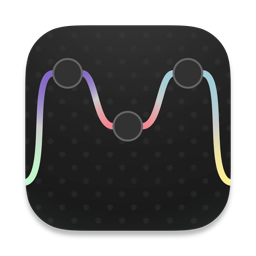

<h1 align="center">Mosaic</h1>

  <b>Your team's real apps, on one shared table.</b> 
  A board where everyone brings the apps they work in, live. Files move between computers without ever being uploaded. 
  Peer to peer. No servers holding your work. No accounts.

  <a href="https://github.com/canikatik-rgb/mosaic-updater/releases/latest"><b>Download</b></a> ·
  <a href="https://www.mosaicanvas.com">Website</a> ·
  <a href="https://www.mosaicanvas.com/changelog">What's new</a> ·
  <a href="https://www.mosaicanvas.com/meet">Meet in the browser</a>

  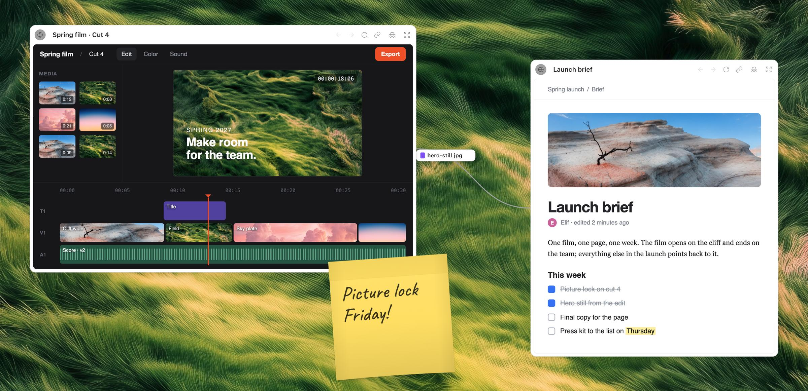

## What is Mosaic?

Mosaic is a desktop app for macOS and Windows. It's an infinite board where everyone brings what they already work in: web apps, and the desktop apps on their own computer (a video editor, a 3D tool, a design app). Each one runs on its owner's computer, signed in as them, and everyone at the table watches it live.

Draw a line between two of them and files travel along it: export something in one app, and it's already waiting in the next one, on someone else's computer. No attachment, no link, no upload.

When it's time to talk, go through a door on the board into a room: a meeting room with a screen and a table for files, a cinema, a library, a focus room.

Boards live only on the computers of the people on them. There is no Mosaic server holding your work, and no account to create.

## Download

The latest version is in **[Releases](https://github.com/canikatik-rgb/mosaic-updater/releases/latest)**, and on [the website](https://www.mosaicanvas.com). Mosaic updates itself after that.

| Platform | File |
|---|---|
| macOS, Apple silicon | `Mosaic-<version>-arm64.dmg` |
| macOS, Intel | `Mosaic-<version>-x64.dmg` |
| Windows 10 and 11 | `Mosaic-Setup-<version>.exe` |
| Linux (Mosaic Server only) | `Mosaic-<version>-linux-x64.tar.gz`, `-linux-arm64.tar.gz` |

The Mac app is signed and notarized by Apple. The Linux archives run [Mosaic Server](https://www.mosaicanvas.com/server) on a server or a NAS; they aren't a desktop app.

No download is needed to join: anyone can open an invite or a meeting link in their browser.

## Highlights

<table>
  <tr>
    <td width="50%">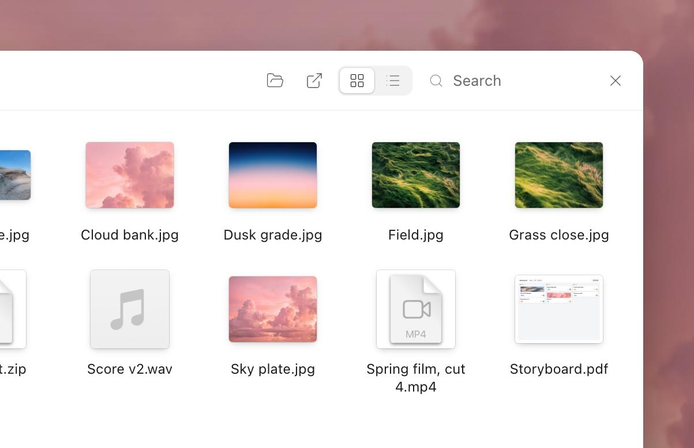</td>
    <td width="50%">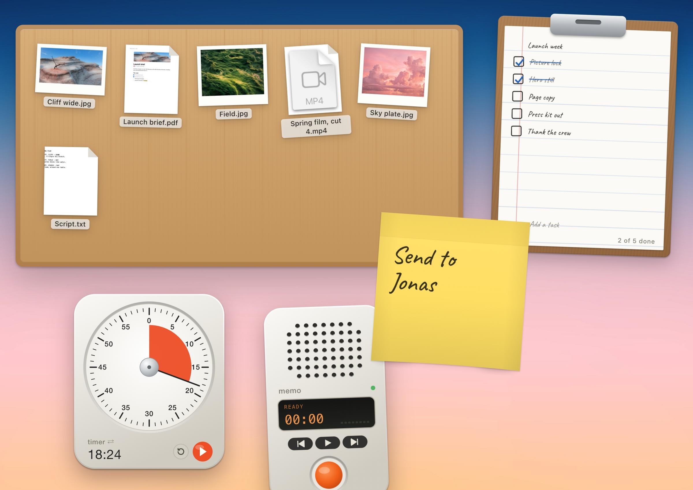</td>
  </tr>
  <tr>
    <td><b>A real folder, on the board.</b> Put a folder from your computer on the board. Anyone can open it in its own window and take what they need. Files only travel when someone opens or saves them, and nobody can write into yours unless you make it a collaborative folder.</td>
    <td><b>The desk.</b> Sticky notes, a timer, a voice memo recorder, a record player, a task list, a wall calendar, a teleport… Desk objects made like the real thing, and everyone at the table can use them.</td>
  </tr>
</table>

- **Web and desktop apps, live.** Paste a link, or pick an app that's open: it shows on the board in its own shape. Double-click it and you work in it at full size.
- **Hand someone the mouse.** A teammate asks to use your page or app, or you hand it to them, for 2 to 30 minutes. They work in it with their own mouse and keyboard while you watch, and you take it back whenever you like.
- **Files, bridged between computers.** Files travel along the lines between nodes, straight from one computer to the next, resuming where they left off and checked byte for byte when they land.
- **Rooms behind doors.** A meeting room with a screen to present on, a whiteboard on its back and a table that takes files; a cinema that plays films in their original quality; a library, an archive, a focus room, a workshop.
- **Meetings from a link.** Start a meeting at [mosaicanvas.com/meet](https://www.mosaicanvas.com/meet), in the browser, with nothing to install. Files put on its table reach everyone, and stay after the person who brought them leaves.
- **Everything you'd do at a real table.** Invite links and a knock to come in, roles (owner, partner, member, observer), live cursors, follow mode, "Look here", spatial audio, cameras with background effects, chat, and session history.
- **Private pages.** Mark a page private and it never leaves your screen; others see that it's there, not what's in it.
- **Works on your network.** In the same office, Mosaic finds the others on the local network and keeps working without the internet.
- **Mosaic Server.** Keep your team's boards and their files on your own server or NAS, always on.
- **Bring your own AI.** Invite an agent (Claude, OpenAI or Gemini, with your own API key) to read the board, write sticky notes, open pages and arrange nodes. Optional MCP tools, each asked for before use.

  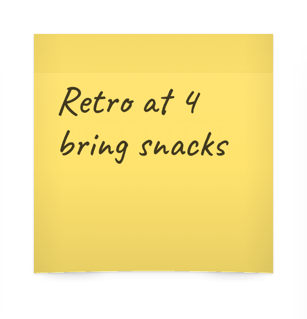
  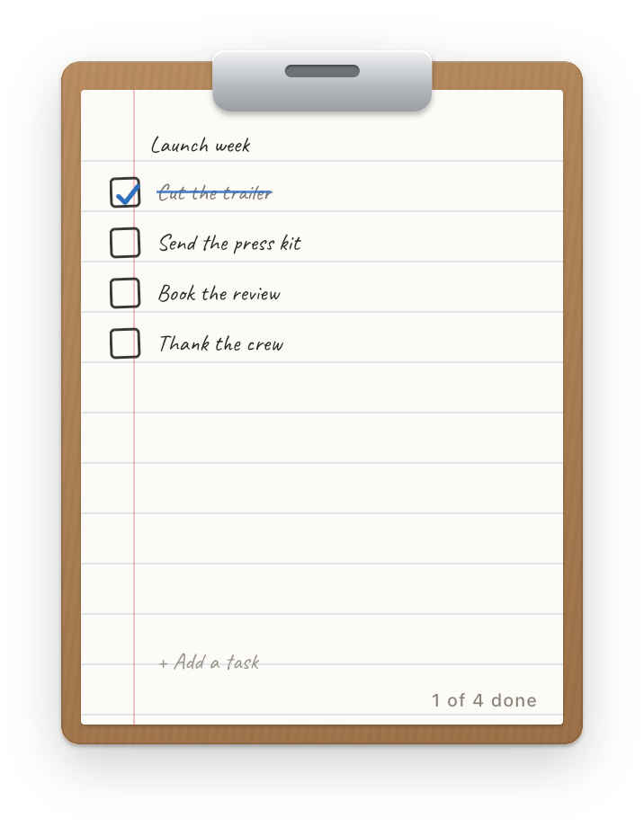
  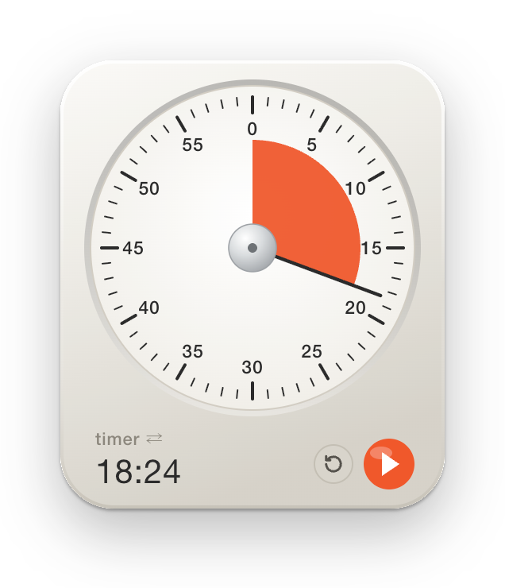
  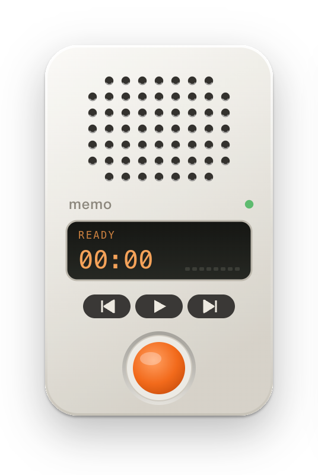
  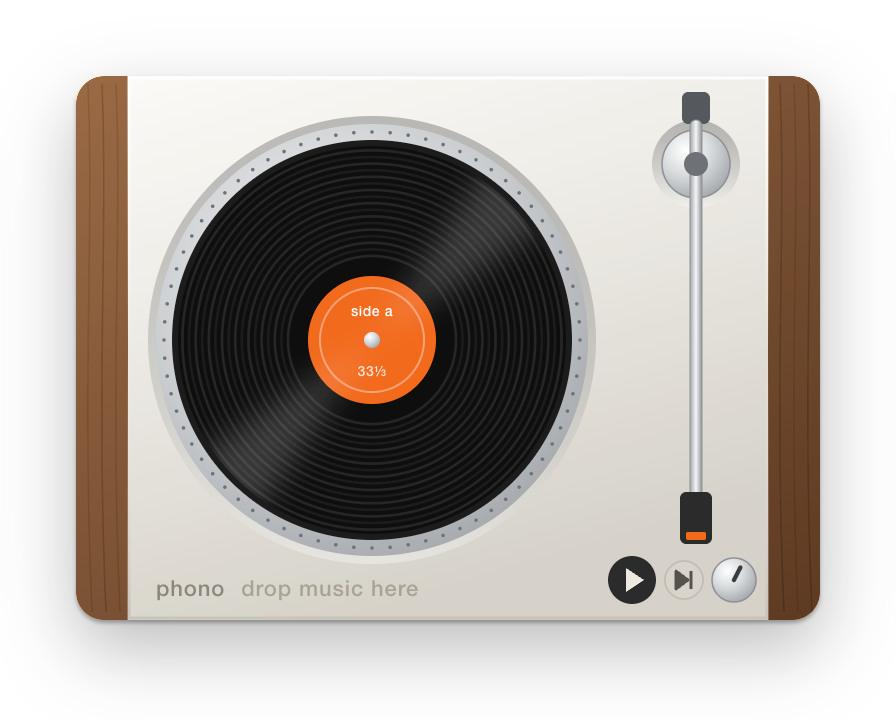
  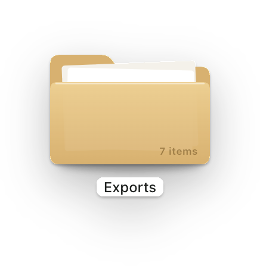
  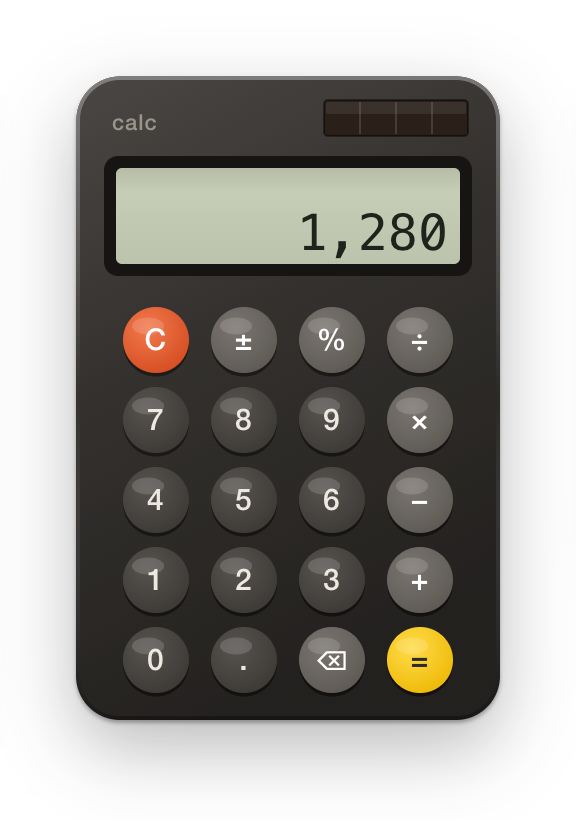
  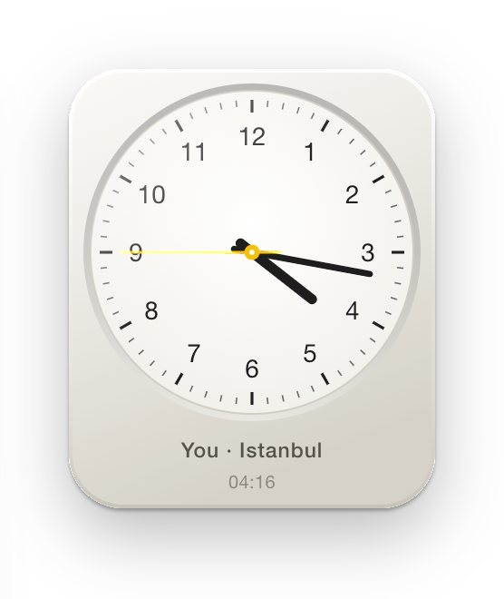

## How it works

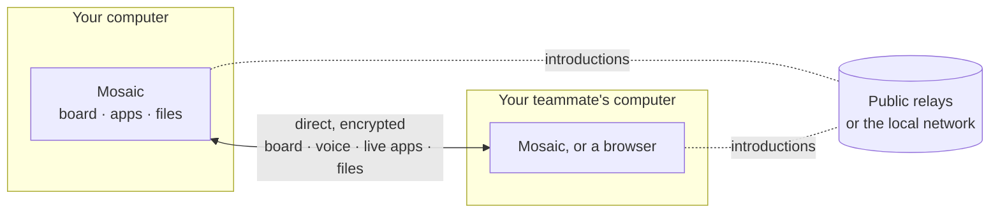

- **Local first.** A board is a CRDT document kept on the computer of everyone on it and synced between them; there is no copy anywhere else, unless you run your own Mosaic Server.
- **Peer to peer.** Computers connect directly over WebRTC, encrypted with the board's own key. Public relays (or the local network) only introduce them to each other; they never see the work. Where a firewall allows no direct route, an encrypted relay passes it on, unread.
- **Apps stay with their owner.** A page or an app runs on its owner's machine. Others receive a live picture of it, never its cookies, passwords or session.
- **Built with** Electron, React, TypeScript and Yjs.

## Pricing

**Mosaic Free**: 3 boards of your own with up to 3 people each, files up to 2 GB, and everything about privacy. **Mosaic Pro**: $49, one payment, updates for good: boards of up to 15 people, no limits on rooms, app windows or file sizes, collaborative folders, asking to use a teammate's page or app, AI agents and Mosaic Server. Details are on [the website](https://www.mosaicanvas.com/#pricing).

## Privacy

No accounts, no analytics in the app, no ads, and no servers holding your boards. What little data exists and where it goes is written down in the [privacy policy](https://www.mosaicanvas.com/privacy).

## Feedback

Found a bug or have an idea? [Open an issue](https://github.com/canikatik-rgb/mosaic-updater/issues).

## License

Mosaic is proprietary software; this repository hosts its release builds only. Using it means agreeing to the [terms of use](https://www.mosaicanvas.com/terms).

© 2026 Caner Atik

